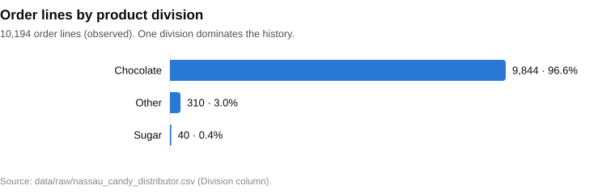
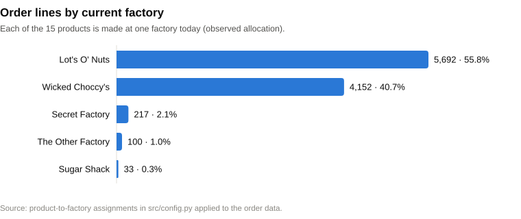
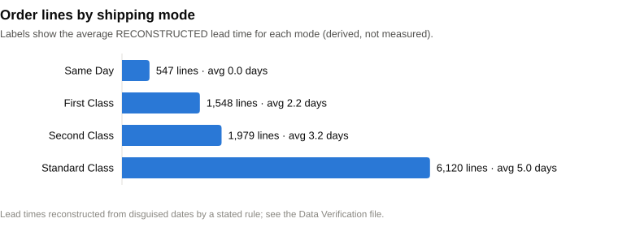
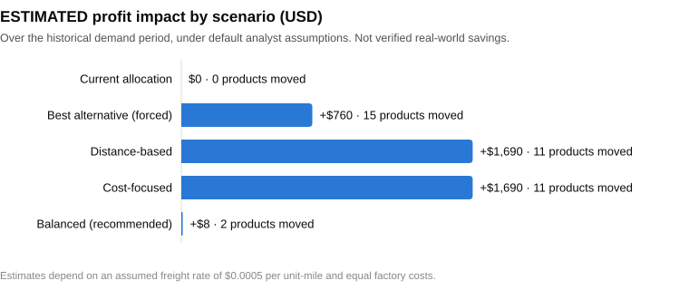

# NexRoute AI

## Executive Summary for Government Stakeholders

**Factory Reallocation & Shipping Optimization Recommendation System**

**Organization / Dataset:** Nassau Candy Distributor (historical order data)

**Status:** Project prototype (decision-support system). It is not deployed in any organization.

---

## 1. Executive Overview

Nassau Candy Distributor makes 15 products at 5 factories and ships them to customers across the United States and
Canada. Each product is currently made at a single factory. The question this project addresses is simple: **would
making some products at a different factory reduce shipping cost or delivery time, and is the change worth the risk?**

NexRoute AI is a decision-support prototype that answers this question using the distributor's historical order data
(10,194 order records). It analyses where customers are, how products are shipped and what deliveries cost. It then
compares every factory option for every product and recommends whether to keep or move each product. Each
recommendation comes with an explanation, a risk rating and the assumptions behind it.

The analysis combines data checks, a delivery-time prediction model, map-based distance analysis, "what-if" scenarios
and a mathematical optimization method that selects the best allowed combination of factories.

**Main outcome.** Under the default assumptions, moving three of the five chocolate (Wonka Bar) products to the
factory that is, on average, closer to their customers could save an **estimated $1,690 over the historical period (about 2.4%)**. However, these
moves carry risks that cannot be checked with the available data, so the balanced recommendation is cautious: **move
only two very small products** and validate the larger opportunity with real cost and capacity data first. All savings
figures are estimates, not verified savings.

## 2. The Problem and Why It Matters

Deciding which factory makes which product is a long-term decision with direct operational consequences:

- **Transportation efficiency.** Products made far from their customers travel further, which raises freight cost
  and fuel use.
- **Delivery time.** Longer distances can mean longer deliveries, which affects service levels.
- **Operating cost and profitability.** Freight is a recurring cost; small savings per unit add up over many shipments.
- **Resource utilization.** Factories have limited capacity; allocation must respect what each site can produce.
- **Better planning.** Decisions based on evidence, with stated assumptions, are easier to review and justify than
  decisions based on habit.

**Relevance to government.** The dataset belongs to a private distributor. Its value for government stakeholders is
as a **worked example** of data-driven supply-chain planning. The same approach could support public-sector logistics
and regional planning (see Section 10). It is not an existing government system.

## 3. What NexRoute AI Does

The system follows seven steps:

**Historical Data → Data Analysis → Shipping Prediction → Factory Evaluation → Scenario Simulation → Optimization → Recommendations**

| Step | What happens, in simple terms |
|---|---|
| **1. Historical data** | Reads the distributor's order records: products, customers, destinations, shipping mode, sales and cost. The original file is never changed. |
| **2. Data analysis** | Checks the data for errors and gaps, and records every problem found in a data-quality report. |
| **3. Shipping prediction** | Estimates how many days an order takes to ship, using past patterns. |
| **4. Factory evaluation** | For each product and each of the 5 factories, estimates distance to customers, production and freight cost, delivery time and risk. Factories that are not considered capable of making a product are excluded. |
| **5. Scenario simulation** | Compares five alternative plans side by side using the same assumptions. |
| **6. Optimization** | A mathematical solver chooses the best allowed factory for each product, balancing cost, delivery time and risk. |
| **7. Recommendations** | Produces a ranked list ("keep" or "move") with a written reason, a risk level and a review status for decision-makers. |

Results are shown in an interactive dashboard with eight pages, and every saved result is stored in a database.

## 4. Dataset at a Glance

| Metric | Value |
|---|---:|
| Order records (order lines) | 10,194 |
| Distinct order IDs | 8,549 |
| Customers | 5,044 |
| Products | 15 |
| Product divisions | 3 (Chocolate, Other, Sugar) |
| Factories | 5 |
| Destinations | 59 |
| US states (including District of Columbia) | 49 |
| Canadian provinces | 10 |
| Sales regions | 4 (Pacific, Atlantic, Interior, Gulf) |
| Shipping modes | 4 (Standard, Second, First Class, Same Day) |
| Total sales recorded | $141,784 |
| Gross profit recorded (sales minus product cost, before freight) | $93,443 |
| Missing values in the file | 0 |

## 5. Key Data Findings

**Finding 1 — One division dominates.** Chocolate products are **96.6%** of all order lines (9,844 of 10,194); "Other"
is 3.0% and Sugar only 0.4% (40 lines).
*Meaning:* almost all of the evidence concerns chocolate products.
*Decision impact:* conclusions for Sugar and Other products are much less certain.

**Finding 2 — Several products have very little history.** 7 of the 15 products have fewer than 30 order lines. Some
have as few as 3 (Fun Dip, Everlasting Gobstopper).
*Meaning:* estimates for these products rest on a handful of orders.
*Decision impact:* recommendations for them are flagged as weak and need confirmation.

**Finding 3 — Two factories handle almost everything.** Lot's O' Nuts (Arizona) and Wicked Choccy's (Georgia) make
the five Wonka Bar products and handle **96.6%** of order lines.
*Meaning:* these two sites matter most.
*Decision impact:* any change involving them has the largest financial effect, and the largest risk.

**Finding 4 — The recorded dates could not be used directly.** The gap between order date and ship date in the file
is 904 to 1,642 days (2.5 to 4.5 years) for every order, which cannot be a real shipping time. Investigation showed
two things:

- the order-date years were altered (the order reference numbers carry the original years, 2021–2024);
- the ship dates were all moved forward by exactly 2,000 days.

Reversing this gives shipping times of 0 to 8 days (for all but 2 of the 10,194 lines), which behave as expected for
each shipping mode.
*Meaning:* delivery times in this project are **reconstructed**, not directly observed.
*Decision impact:* they are reliable for comparing shipping modes, but they are not measured delivery records.

**Finding 5 — Shipping mode, not distance, explains delivery time.** Average reconstructed shipping time is about 0
days for Same Day, 2.2 for First Class, 3.2 for Second Class and 5.0 for Standard Class. Shipping mode explains about
**67%** of the variation. Distance to the customer shows **no measurable relationship** with shipping time
(correlation 0.006, where 0 means no relationship).
*Meaning:* the data cannot show that a closer factory ships faster.
*Decision impact:* any delivery-time benefit from moving production comes from an assumption, not from evidence in
this data.

**Finding 6 — Other data-quality issues** (all recorded, none hidden):

- 449 US postal codes lost a leading zero;
- 313 lines are identical apart from their row number, so they may or may not be duplicates;
- 28 customers ship to more than one state (199 lines);
- the 200 Canadian lines can only be located at province level.

These issues do not change the main conclusions, but they show why data maintenance matters.

## 6. Shipping-Time Prediction Results

The system tested five ways of predicting the (reconstructed) shipping time. Each method was trained on older orders
and tested on later ones it had never seen:

| Method | Average error on unseen orders (days) |
|---|---:|
| Simple overall average (reference) | 1.38 |
| **Average for each shipping mode (selected)** | **0.81** |
| Linear Regression | 0.81 |
| Random Forest | 0.82 |
| Gradient Boosting | 0.82 |

**Final selected method on the test orders:**

- average error **0.806 days**
- RMSE **0.986 days** (a measure that penalises large errors)
- R² **0.698**, meaning about 70% of the variation is explained

**What this means in plain terms:**

- The more complex machine-learning models were **no better** than the simple average for each shipping mode. The system therefore uses the simpler method, which is easier to explain and audit.
- This is an honest result. Location, factory, product type, order size and season added nothing measurable to the prediction.
- Each prediction comes with a whole-day range (for example, 4–7 days for Standard Class). On the test orders, every actual value fell inside its range.

**Important:** these predictions describe **reconstructed** shipping times (see Finding 4), not observed real-world
delivery times.

## 7. Factory Reallocation Results

For every product, the system evaluated all five factories against the product's full order history. It considered:

- **product–factory compatibility:** a factory is allowed only if it already makes products of the same division (an assumption; no compatibility data exists);
- **distance** from each factory to the product's customers;
- **estimated costs:** production cost and freight cost, calculated the same way for every factory;
- **estimated profit impact** compared with today;
- **estimated delivery-time change**, using an assumed transit time;
- **risk:** data quality, uncertainty, compatibility, and operational disruption;
- a **reassignment penalty**, so that small gains do not trigger disruptive changes;
- **factory capacity**, where configured (it is switched off by default because no capacity data exists).

The optimization picks the best allowed combination. It **evaluates options; it does not guarantee real-world savings.**

## 8. Scenario Comparison

| Scenario | Products moved | Estimated profit impact | Estimated delivery-time change |
|---|---:|---:|---:|
| Current allocation | 0 | $0 | 0 days |
| Best alternative factory (every product moved) | 15 | +$760 (+1.1%) | −0.08 days |
| Distance-based (nearest allowed factory) | 11 | +$1,690 (+2.4%) | −0.17 days |
| Cost-focused (cheapest allowed factory) | 11 | +$1,690 (+2.4%) | −0.17 days |
| **Balanced (recommended)** | **2** | **+$8** | **about 0 days** |

> **These are estimated scenario outputs based on configurable assumptions and are NOT verified real-world savings.**
> The profit figures cover the whole historical period in the dataset. Percentages are relative to the estimated
> current profit after assumed freight costs ($69,390). The delivery-time changes come entirely from an assumed
> transit time of 2 days per 1,000 miles.

**How to read this:**

- **Where the opportunity is.** Almost all of the estimated $1,690 comes from moving three Wonka Bar products
  (Nutty Crunch Surprise, Fudge Mallows, Scrumdiddlyumptious) from Lot's O' Nuts in Arizona to Wicked Choccy's in
  Georgia. Each is worth between $506 and $633. Weighted by volume, their customers are on average about 150
  miles closer to Georgia than to Arizona (about 1,150 vs 1,310 straight-line miles).
- **Why the balanced plan is cautious.** It weighs this roughly 2% estimated gain against risks the data cannot
  check: whether Wicked Choccy's can actually make these products, whether it has capacity, and what freight really
  costs. It therefore recommends only two moves:
  - **Fun Dip** to Secret Factory (+$1.67 estimated, based on 3 orders);
  - **Laffy Taffy** to The Other Factory (+$6.41 estimated, based on 10 orders).
- **Distance-based and cost-focused give the same answer** because production cost is assumed equal at every
  factory, so cost depends only on distance.

## 9. Most Important Recommendations

1. **Review the chocolate allocation with real data.** Moving three Wonka Bar products to the factory that is, on
   average, closer to their customers is the largest estimated opportunity. Before any decision, confirm production capability and capacity at
   Wicked Choccy's and the actual freight rates.
2. **Use balanced decision-making.** Judge each change on cost, delivery time, risk, compatibility and the disruption
   of moving production together, not on cost alone. Small estimated gains should not trigger disruptive moves.
3. **Treat the two recommended small moves as low-stakes pilots.** Fun Dip and Laffy Taffy have very little order
   history, so the gains are small and uncertain. They are suitable only as pilots.
4. **Improve data quality at source.** Record genuine order, ship and delivery dates, and correct postal codes.
   Capture factory production costs, freight invoices and delivery confirmations.
5. **Validate the assumptions.** Replace the estimated freight cost, factory cost, factory capacity and product
   compatibility with verified operational information.
6. **Monitor actual results.** If changes are made, compare actual cost and delivery performance with the estimates,
   and update the model.

## 10. Relevance for Government Stakeholders

NexRoute AI is a **project prototype built on a private distributor's data**. It is not deployed by, or in partnership
with, any government organization. Its value for the public sector is as a demonstration of an approach that could
support:

- **Supply-chain and regional logistics planning:** deciding where goods are produced or stocked to serve regions efficiently.
- **Transportation efficiency analysis:** identifying where distance, and therefore freight cost and emissions, could be reduced.
- **Data-driven resource allocation:** comparing options transparently under clearly stated assumptions.
- **Public-sector logistics decision support:** for example, warehouse or depot assignment for supplies, with risk and explanation attached to every recommendation.
- **Support for SMEs and manufacturers:** an affordable example of moving from spreadsheets to evidence-based planning, built only with free, open-source tools that run offline.
- **Evidence-based, auditable decisions:** every recommendation records its inputs, assumptions and reasoning, which supports review and accountability.

Any public-sector use would need its own data, validation and stakeholder review.

## 11. Risks and Limitations

1. **Shipping times were reconstructed.** The original dates were altered, so shipping times were rebuilt using a
   tested rule. They are not measured delivery records.
2. **Factory-specific costs were not available.** Production cost is assumed to be the same at every factory.
3. **Freight rates are assumptions.** The default ($0.0005 per unit per mile) is illustrative. The estimated savings
   change in proportion to this rate.
4. **Factory capacity is unknown.** Capacity limits are off by default and can be tested as an assumption.
5. **Product compatibility is assumed.** It is based on which factories already make each product type.
6. **Locations are approximate.** Distances run from each factory to the centre of the customer's state or province,
   in straight lines. Canadian locations are coarse province-level approximations.
7. **Some products have very little history.** 7 of 15 products have fewer than 30 orders.
8. **Results are estimates.** No figure in this report is a realised saving.
9. **Risk scores are rules of thumb.** They are transparent scoring rules on a 0–1 scale, not calibrated probabilities.
10. **Correlation is not causation.** Patterns in historical data do not prove what would happen after a change.

## 12. Implementation Considerations

Before any real-world use, the following would be needed:

- **Verified operational data:** actual freight rates, factory production costs, capacities and confirmed product–factory compatibility.
- **Genuine shipping records:** real ship and delivery dates, to replace the reconstructed times.
- **Validation:** compare the model's estimates with actual cost and delivery performance on recent orders.
- **Stakeholder review:** production, logistics and finance teams review each proposed change. The system's built-in review status (proposed, under review, approved, rejected, implemented) supports this.
- **Regular data updates** and re-running of the analysis.
- **Monitoring** of implemented changes against expected results.

## 13. Expected Benefits

If validated with real data, an approach like NexRoute AI **could**:

- support better-informed factory allocation decisions;
- improve visibility of shipping patterns and costs;
- allow "what-if" testing before committing to changes;
- identify potential cost-saving opportunities, such as the estimated chocolate reallocation;
- make decisions more transparent, because every recommendation is explained and its assumptions are recorded;
- reduce reliance on manual, spreadsheet-based analysis.

No savings are guaranteed. The size of any benefit depends on verified costs and capacities.

## 14. Conclusion

NexRoute AI demonstrates how historical operational data can be turned into practical decision support for factory
allocation and shipping optimization. It combines:

**data analysis + machine learning + geographical analysis + scenario simulation + mathematical optimization**

and produces recommendations that are explained, risk-rated and traceable.

The analysis identifies a potential opportunity: an estimated saving of about 2.4%, mainly from producing three chocolate
products at the factory that is, on average, closer to their customers. It also shows clearly what the data cannot prove. Delivery times had to be
reconstructed, distance shows no measurable effect on shipping time, and costs, capacity and compatibility are
assumptions.

The recommended path is therefore to **use the system to focus attention on the largest opportunity, then validate it
with real operational costs, capacity, compatibility and delivery data before making any implementation decision.**

---

*Prepared from the NexRoute AI project files. Every figure is listed with its source in
EXECUTIVE_SUMMARY_DATA_VERIFICATION.md. Author and institution details are not available in the current project
evidence.*
