# NexRoute AI: Factory Reallocation and Shipping Optimization Recommendation System for Nassau Candy Distributor

**Project:** NexRoute AI — decision-support prototype
**Dataset:** Nassau Candy Distributor historical order data (10,194 order lines)
**Research topic:** Exploratory data analysis, lead-time prediction and constrained optimization for product–factory allocation
**Version:** 2 (2026-10-22). This version replaces an earlier draft that reported superseded results; see `RESEARCH_PAPER_VERIFICATION.md`.

*Author and institutional details are not available in the project documentation and are therefore omitted.*

---

**How to read the numbers.** Every value in this paper is one of three types:

| Type | Meaning |
|---|---|
| **Observed** | Taken unchanged from the source data |
| **Derived** | Computed from observed data by a stated rule |
| **Estimated** | Depends on configurable analyst assumptions; never a verified real-world outcome |

---

## Abstract

Nassau Candy Distributor makes 15 products at five factories and ships them to customers in the United States and
Canada. Each product is currently made at exactly one factory. This study asks whether historical order data can
support a better product-to-factory allocation, one that lowers shipping cost or delivery time without unacceptable
risk.

We analysed 10,194 order lines (5,044 customers, 59 destinations). Exploratory analysis showed that the recorded gap
between order date and ship date (904–1,642 days) is not a real lead time. Forensic analysis found the cause:

- order-date years were relabelled (the order reference carries the original year, 2021–2024);
- ship dates were shifted by exactly 2,000 days.

Reversing this yields a **reconstructed lead time** of 0–8 days for all but 2 lines. Shipping mode explains 67.4% of
its variance; distance to the customer shows no measurable relationship (r = 0.006).

We compared five predictors of the reconstructed lead time using a chronological train/validation/test split, with
model selection on validation data only. A simple **per-shipping-mode mean** performed as well as Linear Regression,
Random Forest and Gradient Boosting, and was selected. On the untouched test set it achieved MAE 0.806 days, RMSE
0.986 days and R² 0.698.

We then evaluated all 75 product–factory combinations with a symmetric cost model, transparent heuristic risk scores
and an exact mixed-integer optimization, under configurable assumptions for freight rate, factory cost, transit time,
capacity and compatibility. Under default assumptions:

| Scenario | Products moved | Estimated profit impact |
|---|---|---|
| Cost-focused and distance-based | 11 | +$1,690 (2.4% of estimated current profit) |
| Balanced (cost, delivery time and risk) | 2 | +$8 |

The cost-focused gain comes almost entirely from three chocolate products. The balanced objective recommends moving
only two small products. All financial results are simulations, not verified savings.

---

## 1. Introduction

Choosing which factory makes which product is a long-term supply-chain decision. It affects transport distance,
freight cost, delivery time and the use of factory capacity. Firms often keep historical allocations because the
evidence needed to change them is scattered or unreliable.

NexRoute AI is a prototype decision-support system that turns historical order data into explained,
assumption-labelled allocation recommendations. It combines:

- exploratory data analysis;
- data-quality validation;
- lead-time prediction;
- geographic distance analysis;
- scenario simulation;
- mathematical optimization.

Results are presented in an interactive dashboard and stored in a database.

A central theme of this study is **honest reporting under imperfect data**. The dataset's date fields turned out to be
disguised, and the data contains no factory-specific cost, capacity or compatibility information. The study therefore
separates what the data shows from what is assumed, and reports weak or negative findings as they are.

## 2. Problem Statement

Nassau Candy Distributor assigns each of its 15 products to one of five factories. The company needs to know, product
by product:

1. whether making the product at a different factory would reduce estimated shipping cost or delivery time;
2. how large the estimated effect is, and how certain it is;
3. which risks a change would introduce;
4. which allocation is best when cost, delivery time and risk are considered together.

These questions must be answered from historical order data in which:

- delivery dates are not directly usable;
- several key business parameters are missing.

## 3. Objectives

1. Profile the dataset and document all data-quality issues with evidence.
2. Establish whether the recorded dates support a valid lead-time measure, and recover one if possible.
3. Build and evaluate lead-time predictors with a leakage-free, chronological methodology.
4. Quantify factory-to-customer distances and the cost of serving each product's demand from each factory.
5. Formulate and solve the allocation problem under explicit, configurable constraints.
6. Compare alternative allocation scenarios under one shared set of assumptions.
7. Produce explained recommendations with transparent risk scores, and state all limitations.

## 4. Dataset Description

The source file (`data/raw/nassau_candy_distributor.csv`) has **10,194 rows and 18 columns with no missing values**.
Each row is one order line.

**Table 1. Dataset overview (observed)**

| Metric | Value |
|---|---:|
| Order lines | 10,194 |
| Distinct order IDs | 8,549 |
| Customers | 5,044 |
| Products | 15 |
| Product divisions | 3 (Chocolate 9,844 · Other 310 · Sugar 40 lines) |
| Factories | 5 |
| Destinations (state/province) | 59 = 49 US states incl. DC + 10 Canadian provinces |
| Countries | United States 9,994 lines · Canada 200 lines |
| Sales regions | 4 (Pacific 3,253 · Atlantic 2,986 · Interior 2,335 · Gulf 1,620) |
| Shipping modes | 4 (Standard 6,120 · Second 1,979 · First 1,548 · Same Day 547) |
| Units | 38,654 |
| Sales | $141,783.63 |
| Gross profit (Sales − Cost; excludes freight) | $93,442.80 (65.9% margin) |
| Order Date as recorded | 2024-01-02 to 2025-12-31 |
| Ship Date as recorded | 2026-06-30 to 2030-06-28 |

**Columns:**

| Group | Columns |
|---|---|
| Identifiers | Row ID, Order ID, Customer ID, Product ID |
| Dates | Order Date, Ship Date |
| Shipping | Ship Mode |
| Geography | Country/Region, City, State/Province, Postal Code, Region |
| Product | Division, Product Name |
| Financial | Sales, Units, Gross Profit, Cost |

**Key structural observations:**

- The Order ID embeds the original order year, the Customer ID and the Product ID. It therefore identifies a
  customer–product order group, not a basket: 1,373 IDs repeat across 3,018 lines.
- Unit price and unit cost are constant for each product.
- Gross Profit equals Sales − Cost exactly on every row.

**Factory and assignment data** (not part of the CSV) were supplied with the project:

- five factory coordinates;
- 15 baseline product-to-factory assignments.

**Not available in the data:** factory-specific production cost, freight rates, factory capacity, product–factory
compatibility, and genuine delivery timestamps.

## 5. Exploratory Data Analysis

### 5.1 Products

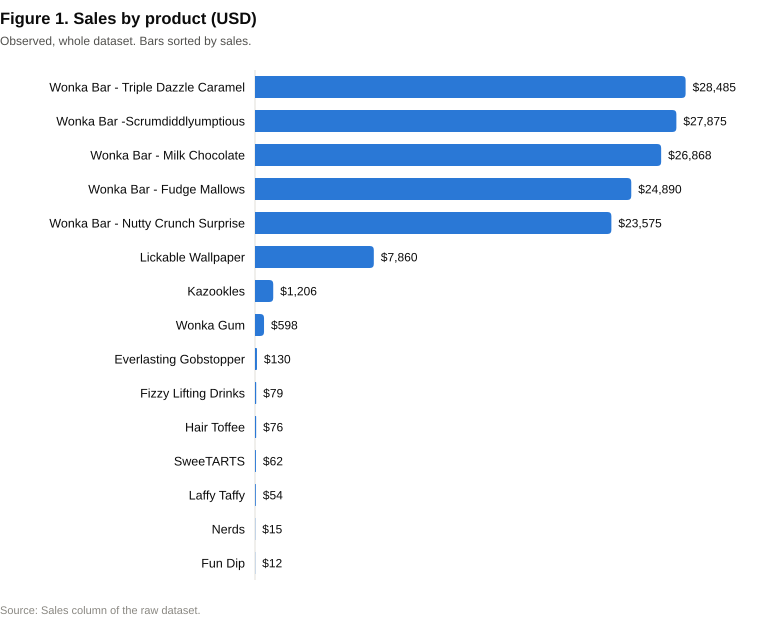

**Product sales are highly concentrated:**

- The top product is Wonka Bar – Triple Dazzle Caramel, with $28,485 of sales.
- The five Wonka Bar (Chocolate) products together account for **92.9%** of sales.
- The lowest-selling product is Fun Dip, with $12 from 3 order lines.

**Many products have very little history.** Seven of the 15 products have fewer than 30 order lines: Everlasting
Gobstopper 3, Fun Dip 3, Nerds 4, Hair Toffee 4, Fizzy Lifting Drinks 6, SweeTARTS 10, Laffy Taffy 10. Any estimate for
these products rests on very little evidence.

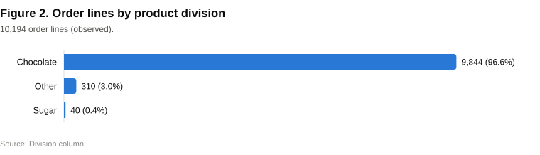

### 5.2 Customers

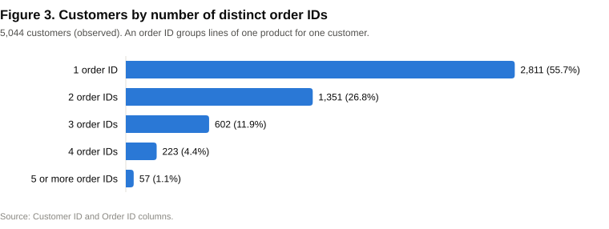

The customer base is broad and not concentrated:

- customers have on average 1.69 distinct order IDs (maximum 15);
- 55.7% have only one;
- the ten largest customers account for 1.15% of order IDs.

Allocation decisions therefore affect many small customers, not a few key accounts. 28 customers ship to more than one
state (199 lines), so geography in this study is taken from each order line rather than from the customer record.

### 5.3 Geography

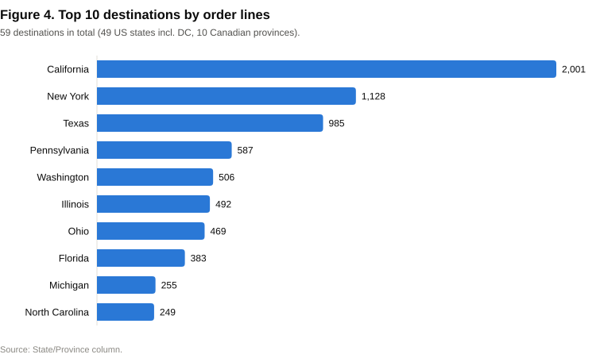

Demand is spread across 59 destinations. The five largest (California 2,001, New York 1,128, Texas 985,
Pennsylvania 587, Washington 506 lines) together hold 51.1% of order lines.

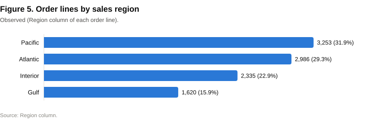

**How distances are measured.** Distances use the Haversine great-circle formula (Sinnott, 1984). They run from each
factory's supplied coordinates to the **centroid** of the destination state or province. They are straight-line
approximations, not road distances. Customer addresses are not geocoded, and Canadian province centroids are coarse.

A descriptive K-Means clustering of destination centroids, weighted by units, found two demand clusters (East and
West). The best silhouette score (Rousseeuw, 1987) was 0.513, at k = 2.

### 5.4 Shipping modes and the date anomaly

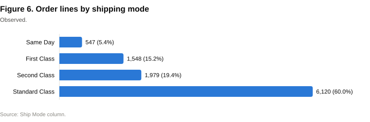

Standard Class is used on 60.0% of order lines.

**The raw gap is not a lead time.** The raw gap between Ship Date and Order Date is 904–1,642 days (mean 1,320.8,
SD 262.4) for every row. It does not behave like a lead time: Same Day orders show the same multi-year gap as Standard
Class (Figure 7), and shipping mode explains only 0.12% of its variance.

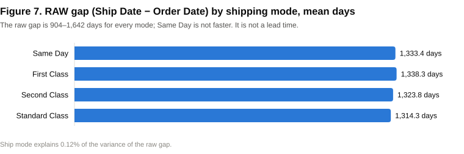

**Forensic analysis.** Two observations together explain the anomaly:

1. **The Order Date year was relabelled.** The year embedded in each Order ID (2021–2024) is the original order year,
   and two original years map onto each recorded year (Table 2).
2. **Ship Date was shifted by a constant.** For every row,
   `Ship Date − (Order Date with its year replaced by the Order ID year) = 2,000 + k days`.

Here k is between 0 and 8 for all but two rows (two rows show 11).

**Table 2. Order ID year vs recorded Order Date year (observed, order lines)**

| Order ID year | Recorded 2024 | Recorded 2025 |
|---|---:|---:|
| 2021 | 2,051 | 0 |
| 2022 | 2,130 | 0 |
| 2023 | 0 | 2,634 |
| 2024 | 0 | 3,379 |

We define k as the **reconstructed lead time** (`lead_time_recovered_days`). It is **derived, not measured**. Its
validity rests on the rule above, which is supported by three pieces of evidence:

- Same Day lines are almost all 0 days;
- the per-mode ranges match the semantics of each shipping mode (Figure 9);
- shipping mode explains 67.4% of its variance.

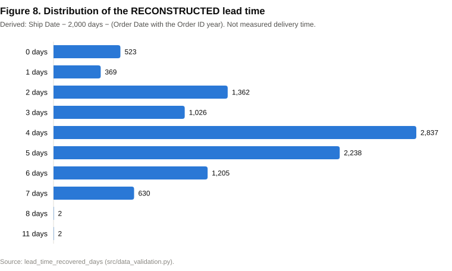

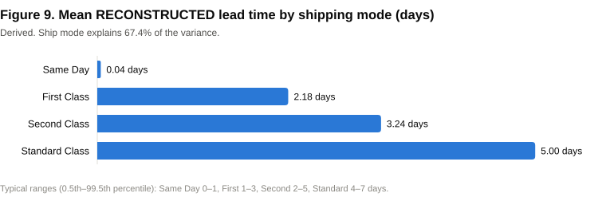

### 5.5 Factories

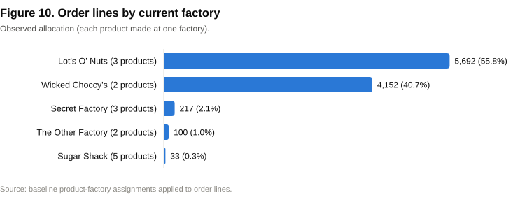

**Two factories handle almost all the volume.** Lot's O' Nuts (Arizona) and Wicked Choccy's (Georgia) make the five
Wonka Bars and handle 96.6% of order lines. Sugar Shack makes five products but has only 33 order lines. Evidence about
the three smaller factories is therefore limited.

**Reconstructed lead time barely differs between factories.** By current factory, the mean ranges from 3.69 to 4.36
days, and by region from 3.91 to 4.05 days.

### 5.6 Correlation analysis

**Table 3. Pearson correlations (observed and derived variables)**

| | Sales | Units | Cost | Gross Profit | Distance | Reconstructed lead time |
|---|---:|---:|---:|---:|---:|---:|
| Sales | 1 | 0.729 | 0.959 | 0.976 | −0.011 | 0.008 |
| Units | 0.729 | 1 | 0.563 | 0.816 | 0.011 | 0.021 |
| Distance | −0.011 | 0.011 | −0.032 | 0.006 | 1 | **0.006** |

**Distance shows no measurable linear relationship with the reconstructed lead time.** The correlation is r = 0.006
for all rows and 0.002 for US rows only. The financial variables correlate strongly with each other, as expected,
because price and unit cost are fixed per product.

These are correlations only. No causal claim is made.

### 5.7 Data quality

**Table 4. Data-quality findings (automated checks in `src/data_validation.py`)**

| Severity | Finding | Records |
|---|---|---:|
| Critical | Raw date gap is not a lead time (904–1,642 days; ship mode explains 0.12%) | 10,194 |
| Critical | Dates disguised: year relabelled, ship date shifted by 2,000 days | 10,194 |
| High | Lead time reconstructed by rule (derived, not measured) | all lines |
| High | 7 products with fewer than 30 order lines | 40 lines |
| Medium | Canadian destinations use approximate province centroids | 200 |
| Medium | Customers shipping to more than one state | 199 |
| Low | Lines identical except Row ID (possible duplicates; kept and flagged) | 313 |
| Low | Order ID is an order + product group, not a basket | 3,018 |
| Low | US postal codes that lost a leading zero | 449 |
| Info | Missing values | 0 |
| Info | Gross Profit = Sales − Cost holds on every row | 0 exceptions |
| Info | No factory cost, freight, capacity or compatibility data in the source | — |

## 6. Data Preprocessing

Preprocessing is implemented in `src/preprocessing.py` and `src/data_validation.py`. The raw file is never modified.

1. **Schema validation.** Processing stops with an explicit error if the file is empty or a required column is missing.
2. **Parsing.** Dates are parsed as DD-MM-YYYY (0 failures) and numeric fields are converted. Unparseable rows would
   be dropped and logged; none were found, so all 10,194 rows are retained.
3. **Date forensics and lead-time reconstruction.** The steps are:
   - rebuild the original order date from the Order ID year;
   - estimate the shift (2,000 days, from Same Day rows);
   - compute k;
   - mark values outside 0–14 days as missing.

   None were outside that range.
4. **Flags.** Possible duplicate lines, Canadian centroid use, and customers with several destinations are flagged,
   not removed.
5. **Features.** The engineered features are:
   - current factory (from the baseline assignment);
   - straight-line distance from that factory to the destination centroid;
   - order month;
   - weekday of the *rebuilt* order date.

   Calendar fields of the disguised Order Date (year, weekday) are excluded from modelling, because they encode the
   disguise rather than shipping behaviour.

## 7. Methodology Overview

The system is built as one pipeline:

**Historical data → validation and preprocessing → lead-time prediction → evaluation of every product–factory option →
scenario simulation → optimization → recommendations, persisted in SQLite and shown in a Streamlit dashboard.**

Every option is evaluated against the product's **full historical demand**: all its order lines, destinations and
shipping modes. All scenarios share one candidate table and one assumption set, so their results are directly
comparable.

## 8. Machine Learning Models

**Target.** The reconstructed lead time, in days.

**Features.** Ship Mode, Region, Division, current factory, distance, Units, Sales, order month, and weekday of the
rebuilt order date.

**Models compared:**

| Model | Description | Reference |
|---|---|---|
| Overall mean (baseline) | Predicts the training mean for every order | — |
| **Per-shipping-mode mean (baseline)** | Predicts the training mean for each shipping mode | — |
| Linear Regression | One-hot encoded categories, standardised numbers | Pedregosa et al., 2011 |
| Random Forest | 200 trees, max depth 8, min leaf 20 | Breiman, 2001 |
| Gradient Boosting | 200 trees, depth 3, learning rate 0.05, subsample 0.8 | Friedman, 2001 |

**Validation protocol.** Rows are ordered by the rebuilt original order date and split chronologically, so the model
is always tested on later orders than it was trained on:

| Set | Rows | Period |
|---|---:|---|
| Train | 7,135 | 2021-01-03 → 2024-03-09 |
| Validation | 1,529 | 2024-03-09 → 2024-09-11 |
| Test | 1,530 | 2024-09-11 → 2024-12-30 |

- **Time-ordered cross-validation.** Five-fold time-series cross-validation inside the training period checks
  stability (Hyndman & Athanasopoulos, 2021).
- **Selection.** The model with the lowest **validation** MAE is selected. A simpler model wins if it is within 1% of
  the best. The test set plays no part in selection.
- **Final evaluation.** The selected model is refit on train + validation and evaluated **once** on the test set.
- **Diagnostics.** These include:
  - permutation feature importance on the validation set (Breiman, 2001);
  - residuals by shipping mode;
  - whole-day prediction ranges built from the 5th–95th percentiles of validation residuals.

  Lead times are whole days, so each range edge is snapped to the nearest whole day when within 0.1 day, and otherwise
  rounded outward.

## 9. Model Evaluation

**Table 5. Model comparison (target: reconstructed lead time, days)**

| Model | CV MAE (train) | Validation MAE | Validation R² | Test MAE | Test RMSE | Test R² |
|---|---:|---:|---:|---:|---:|---:|
| Overall mean | 1.331 | 1.361 | −0.005 | 1.381 | 1.798 | −0.003 |
| **Per-shipping-mode mean (selected)** | 0.811 | **0.828** | 0.672 | 0.807 | 0.986 | 0.698 |
| Linear Regression | 0.823 | 0.830 | 0.671 | 0.812 | 0.985 | 0.699 |
| Random Forest | 0.833 | 0.846 | 0.668 | 0.817 | 0.989 | 0.697 |
| Gradient Boosting | 0.839 | 0.844 | 0.669 | 0.819 | 0.989 | 0.696 |

The selected model, refit on train + validation, was evaluated on the test set:

| Metric | Value |
|---|---:|
| MAE | **0.806 days** |
| RMSE | **0.986 days** |
| R² | **0.698** |

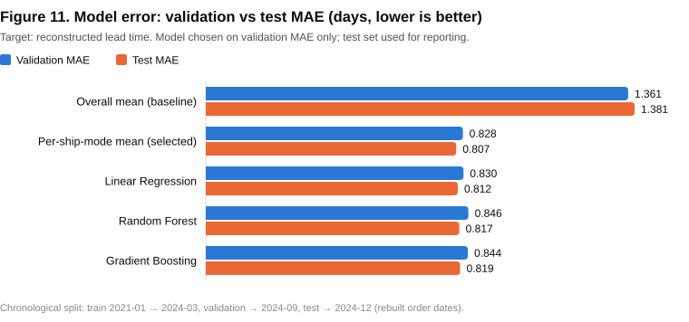

**Interpretation:**

- **Ship mode is the only predictive feature.** The per-shipping-mode mean is statistically indistinguishable from the
  ML models, and permutation importance (Figure 12) confirms why. Distance, factory, region, division, order size and
  season contribute nothing measurable.
- **The simpler model was kept by design.** The parsimony rule selected the simpler, fully explainable model. No
  attempt was made to inflate accuracy.
- **Errors vary by shipping mode.** By mode, test MAE is 0.10 days for Same Day, 0.67 for First, 1.03 for Second and
  0.85 for Standard Class. This error is the spread of lead time *within* each mode, which none of the available
  features explain.

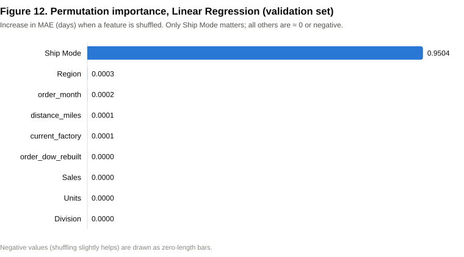

**Prediction ranges.** The whole-day ranges are Same Day 0–1, First 1–3, Second 2–5 and Standard 4–7 days. They are
nominally 90% ranges, but their **measured coverage on the test set is 100%**. Because lead times take only a few
whole-day values, each range spans almost all observed values.

**Scope.** All metrics refer to the **reconstructed** lead time, not to observed delivery times.

## 10. Optimization Methodology

### 10.1 Candidate evaluation

For each product *p* and factory *f*, the product's historical demand (units and revenue by destination) is evaluated
with a **symmetric cost model**. The same formula applies to the current factory and to every alternative:

- revenue = historical sales (customers and prices are unchanged);
- production cost = historical cost × *m*, where *m* = 1 at the current factory and the alternative-factory
  multiplier elsewhere;
- freight cost = Σ units × distance(*f*, destination) × freight rate;
- estimated profit = revenue − production cost − freight cost;
- profit impact = estimated profit(*f*) − estimated profit(current factory).

**Estimated lead time** for *p* at *f* = predicted processing time (the model applied to the product's actual order
lines) + transit time. Transit time is the demand-weighted distance × an *assumed* number of transit days per 1,000
miles. Because the data shows no distance effect, any lead-time difference between factories comes from this
assumption.

### 10.2 Risk scores

Five heuristic components, each on a 0–1 scale, are averaged:

| Component | Formula |
|---|---|
| Model uncertainty | Validation MAE ÷ mean lead time, + 0.30 if the product has never been made at *f* |
| Data quality | 0.30 for the derived target, + 0.70 × share of flagged lines, + 0.30 if fewer than 30 lines |
| Missing information | Share of six inputs that are assumptions |
| Compatibility | 0 current; 0.5 assumed via division; 0.9 if any factory is allowed |
| Operational | 0.30 + 0.50 × moved share of the receiving factory's volume, + 0.20 if capacity is not modelled |

The overall score is the mean of the five (Low < 0.35 ≤ Medium < 0.60 ≤ High). These are **transparent rules of thumb,
not calibrated probabilities**. Under the defaults, the overall risk is:

- 0.17–0.23 for current factories;
- 0.53–0.57 for eligible alternatives.

### 10.3 Objective and constraints

The balanced score of moving *p* to *f*, relative to staying (= 0), is:

```
score = w_profit × profit gain (% of revenue) + w_speed × lead-time gain (%)
      − w_risk × risk increase (points) − reassignment penalty (if f ≠ current)
```

The default weights are 0.4 / 0.4 / 0.2 and the default penalty is 2 points.

The allocation is solved exactly as a binary assignment problem with `scipy.optimize.milp` (Virtanen et al., 2020),
which uses the HiGHS solver (Huangfu & Hall, 2018). It maximises the total score subject to:

- exactly one factory per product;
- *x*(*p*, *f*) = 0 if *f* is incompatible with *p*;
- *x*(*p*, *f*) = 0 if the move's profit impact is below the minimum threshold;
- optionally, the units assigned to each factory ≤ its current units × (1 + headroom).

Keeping the current factory is always feasible. Infeasible settings are reported with a reason, not forced. As an
independent check, the solver's solutions were confirmed by brute-force enumeration of all feasible allocations.

### 10.4 Assumptions

**Table 6. Configurable assumptions (none come from the data)**

| Assumption | Default | Basis |
|---|---|---|
| Freight rate | $0.0005 per unit-mile | Illustrative placeholder |
| Alternative-factory production cost | × 1.0 | No factory cost data |
| Transit time | 2 days per 1,000 miles | Rule of thumb; not supported by the data |
| Factory capacity | Not limited | No capacity data |
| Minimum profit impact to move | $0 | A move must not reduce estimated profit |
| Reassignment penalty | 2 score points | Stands in for unknown switching costs |
| Compatibility | Factory already makes the product's division | Derived from the baseline; unverified (22 eligible alternatives) |

### 10.5 Scenarios

| Scenario | How each product's factory is chosen |
|---|---|
| Current | Today's factory |
| Best alternative | Forced move to the best-scoring compatible alternative |
| Distance-based | Nearest compatible factory |
| Cost-focused | Maximum estimated profit |
| Balanced | The recommendation objective above |

## 11. Results and Discussion

### 11.1 Scenario comparison

**Table 7. Scenario results (estimated, historical demand period, default assumptions)**

| Scenario | Products moved | Est. profit impact | % of est. current profit | Est. lead-time change (unit-weighted) | Solver |
|---|---:|---:|---:|---:|---|
| Current | 0 | $0 | 0.0% | 0.00 days | optimal |
| Best alternative (forced) | 15 | +$760 | +1.1% | −0.08 days | optimal |
| Distance-based | 11 | +$1,690 | +2.4% | −0.17 days | optimal |
| Cost-focused | 11 | +$1,690 | +2.4% | −0.17 days | optimal |
| **Balanced (recommended)** | **2** | **+$8** | **+0.01%** | **≈ 0 days** | optimal |

The percentages are relative to the estimated current profit after assumed freight costs ($69,390).

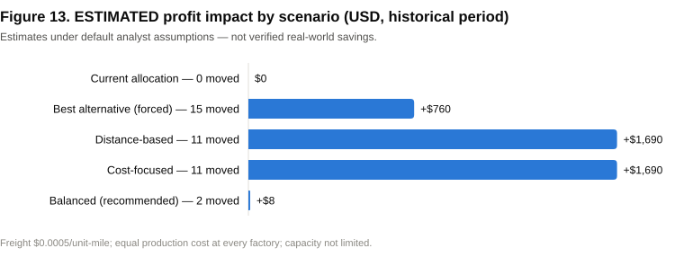

**Distance-based and cost-focused are identical.** With equal production cost at every factory, estimated cost
depends only on distance. The lead-time changes are entirely the transit-time assumption.

**Where the estimated gain comes from.** In the cost-focused scenario, 98.8% of the gain comes from three products
(Table 8, Figure 14):

- Wonka Bar – Scrumdiddlyumptious (+$633.00);
- Wonka Bar – Nutty Crunch Surprise (+$529.78);
- Wonka Bar – Fudge Mallows (+$506.41).

All three would move from Lot's O' Nuts (Arizona) to Wicked Choccy's (Georgia). Weighted by volume, their customers
are on average about 150 miles closer to Georgia: roughly 1,150 versus 1,310 straight-line miles.

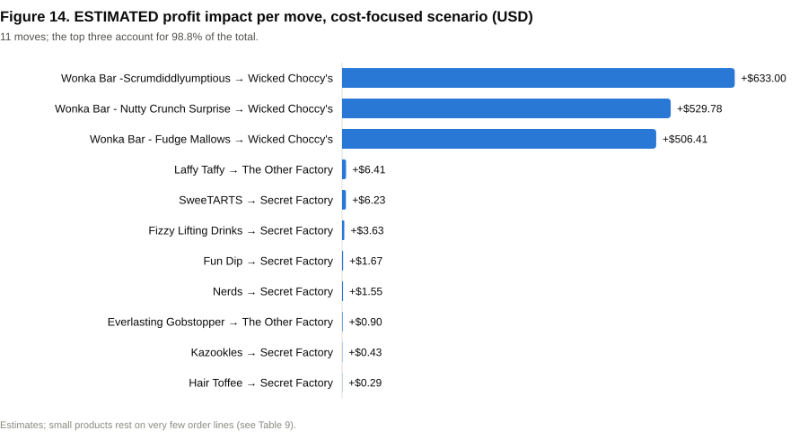

**Table 8. Cost-focused scenario moves (estimated)**

| Product | From → To | Order lines | Est. profit impact |
|---|---|---:|---:|
| Wonka Bar – Scrumdiddlyumptious | Lot's O' Nuts → Wicked Choccy's | 2,064 | +$633.00 |
| Wonka Bar – Nutty Crunch Surprise | Lot's O' Nuts → Wicked Choccy's | 1,810 | +$529.78 |
| Wonka Bar – Fudge Mallows | Lot's O' Nuts → Wicked Choccy's | 1,818 | +$506.41 |
| Laffy Taffy | Sugar Shack → The Other Factory | 10 | +$6.41 |
| SweeTARTS | Sugar Shack → Secret Factory | 10 | +$6.23 |
| Fizzy Lifting Drinks | Sugar Shack → Secret Factory | 6 | +$3.63 |
| Fun Dip | Sugar Shack → Secret Factory | 3 | +$1.67 |
| Nerds | Sugar Shack → Secret Factory | 4 | +$1.55 |
| Everlasting Gobstopper | Secret Factory → The Other Factory | 3 | +$0.90 |
| Kazookles | The Other Factory → Secret Factory | 96 | +$0.43 |
| Hair Toffee | The Other Factory → Secret Factory | 4 | +$0.29 |

### 11.2 Balanced recommendations

The balanced objective recommends **two reallocations** and **keeping 13 products** at their current factory
(Table 9). Both moves concern very small products and carry Medium risk:

- **Fun Dip:** Sugar Shack → Secret Factory, +$1.67 estimated, 3 order lines;
- **Laffy Taffy:** Sugar Shack → The Other Factory, +$6.41 estimated, 10 order lines.

**Why the balanced objective rejects the three Wonka Bar moves.** Their estimated profit gain is only about 2% of each
product's revenue, while their risk rises from Low to Medium:

- the production move is unverified;
- the lead time at the new factory is an extrapolation;
- the costs are assumed.

The risk term and the reassignment penalty outweigh the gain (scores between −6.28 and −6.55). This is a deliberate,
transparent trade-off, not a data result. It changes with the weights.

**Table 9. Balanced recommendations (estimated; score of staying = 0)**

| Rank | Product | Current factory | Decision | Best compatible alternative (score) | Order lines |
|---:|---|---|---|---|---:|
| 1 | Fun Dip | Sugar Shack | **Move → Secret Factory** | Secret Factory (+2.94) | 3 |
| 2 | Laffy Taffy | Sugar Shack | **Move → The Other Factory** | The Other Factory (+1.96) | 10 |
| 3 | SweeTARTS | Sugar Shack | Keep | Secret Factory (−0.94) | 10 |
| 4 | Nerds | Sugar Shack | Keep | Secret Factory (−0.96) | 4 |
| 5 | Fizzy Lifting Drinks | Sugar Shack | Keep | Secret Factory (−2.32) | 6 |
| 6 | Wonka Bar – Scrumdiddlyumptious | Lot's O' Nuts | Keep | Wicked Choccy's (−6.28) | 2,064 |
| 7 | Wonka Bar – Nutty Crunch Surprise | Lot's O' Nuts | Keep | Wicked Choccy's (−6.32) | 1,810 |
| 8 | Everlasting Gobstopper | Secret Factory | Keep | The Other Factory (−6.43) | 3 |
| 9 | Wonka Bar – Fudge Mallows | Lot's O' Nuts | Keep | Wicked Choccy's (−6.55) | 1,818 |
| 10 | Hair Toffee | The Other Factory | Keep | Secret Factory (−7.93) | 4 |
| 11 | Kazookles | The Other Factory | Keep | Secret Factory (−9.09) | 96 |
| 12 | Wonka Gum | Secret Factory | Keep | The Other Factory (−9.79) | 120 |
| 13 | Lickable Wallpaper | Secret Factory | Keep | The Other Factory (−10.72) | 94 |
| 14 | Wonka Bar – Triple Dazzle Caramel | Wicked Choccy's | Keep | Lot's O' Nuts (−10.77) | 2,015 |
| 15 | Wonka Bar – Milk Chocolate | Wicked Choccy's | Keep | Lot's O' Nuts (−11.59) | 2,137 |

### 11.3 Sensitivity

**Table 10. Sensitivity of the cost-focused scenario (estimated)**

| Change from defaults | Products moved | Est. profit impact |
|---|---:|---:|
| None (default) | 11 | +$1,690 |
| Freight rate doubled ($0.001 per unit-mile) | 11 | +$3,381 |
| Capacity limited to current volume + 10% | 9 | +$292 |

The estimated gain scales linearly with the assumed freight rate. It falls sharply once Wicked Choccy's cannot absorb
all three Wonka Bar products. **Capacity is therefore the key unknown for the main opportunity.**

### 11.4 Discussion

The study produces three findings of different strength:

| Strength | Finding |
|---|---|
| **Strong (derived from data)** | Recorded dates are disguised; a valid lead time can be reconstructed; ship mode, not distance, explains it. |
| **Moderate (observed geography + assumed freight)** | Serving three Wonka Bar products from Georgia instead of Arizona would shorten demand-weighted distance by about 150 miles per unit. |
| **Weak (assumption-driven)** | The size of any saving, and any delivery-time benefit. Both depend entirely on unverified freight, cost, transit and capacity assumptions. |

The system's value lies in making this distinction explicit for each recommendation.

## 12. Recommendations

1. **Investigate the Wonka Bar reallocation with real data.** Confirm production capability, capacity and actual
   freight costs at Wicked Choccy's before any decision. This is the only material opportunity identified.
2. **Use the balanced objective for decisions.** Consider cost, delivery time, risk, compatibility and switching cost
   together.
3. **Treat the two small recommended moves (Fun Dip, Laffy Taffy) as low-stakes pilots at most.** Their estimates rest
   on 3 and 10 order lines.
4. **Fix the data at source.** Record genuine order, ship and delivery timestamps. Correct postal codes. Capture factory
   costs, freight invoices and capacities.
5. **Replace every assumption in Table 6 with verified values,** then re-run the analysis.
6. **Monitor outcomes.** Compare actual cost and delivery performance after any change with the estimates, and retrain
   the model.

## 13. Limitations

1. **Reconstructed lead time.** It is derived from disguised dates by a tested rule, but it is not a measured delivery
   time. All prediction metrics refer to it.
2. **Counterfactual alternatives.** Each product has only been made at one factory, so effects at alternative factories
   are extrapolations.
3. **Assumed parameters.** Factory costs, freight rates, transit times, capacity and compatibility are configurable
   assumptions, not data.
4. **Simulated results.** Optimization results are simulations over the historical period, not verified or realised
   savings.
5. **Heuristic risk scores.** Risk scores are transparent heuristics, not calibrated probabilities.
6. **Approximate distances.** Distances are straight lines to state or province centroids. Canadian centroids are
   coarse.
7. **Sparse history.** Seven products have fewer than 30 order lines.
8. **Order IDs.** "Orders" are counted as Order IDs, which combine an order with a product.
9. **Wide prediction ranges.** The prediction ranges are wide: measured coverage is 100% against a nominal 90%.
10. **Correlation only.** Correlational findings do not establish causation.

## 14. Conclusion

This study shows that historical order data can be turned into transparent decision support for factory allocation,
even when the data is imperfect.

**On the data.** The most important analytical result was discovering, and reversing, the disguise in the date fields.
This yielded a reconstructed lead time that behaves consistently with shipping modes. On that target, a simple
per-shipping-mode mean predicts as well as more complex models (test MAE 0.806 days, R² 0.698). Distance has no
measurable effect on lead time.

**On allocation.** Under default assumptions, the cost-focused allocation could raise estimated profit by about $1,690
(2.4%) over the historical period, mainly by producing three Wonka Bar products in Georgia instead of Arizona. The
balanced recommendation, which weighs this gain against unverified risks, moves only two small products.

**Next step.** These results identify where to look, not what to do. The main opportunity should be validated with
real cost, capacity, compatibility and delivery data before any implementation decision.

## 15. References

- Nassau Candy Distributor. Historical order dataset (`nassau_candy_distributor.csv`), supplied as the project's primary data source.
- Bayer, M. (2012). SQLAlchemy. In A. Brown & G. Wilson (Eds.), *The Architecture of Open Source Applications, Volume II*. Lulu.com.
- Breiman, L. (2001). Random forests. *Machine Learning*, 45(1), 5–32.
- Friedman, J. H. (2001). Greedy function approximation: A gradient boosting machine. *The Annals of Statistics*, 29(5), 1189–1232.
- Harris, C. R., Millman, K. J., van der Walt, S. J., et al. (2020). Array programming with NumPy. *Nature*, 585, 357–362.
- Huangfu, Q., & Hall, J. A. J. (2018). Parallelizing the dual revised simplex method. *Mathematical Programming Computation*, 10(1), 119–142.
- Hyndman, R. J., & Athanasopoulos, G. (2021). *Forecasting: Principles and Practice* (3rd ed.). OTexts.
- McKinney, W. (2010). Data structures for statistical computing in Python. *Proceedings of the 9th Python in Science Conference*, 56–61.
- Pedregosa, F., Varoquaux, G., Gramfort, A., et al. (2011). Scikit-learn: Machine learning in Python. *Journal of Machine Learning Research*, 12, 2825–2830.
- Rousseeuw, P. J. (1987). Silhouettes: A graphical aid to the interpretation and validation of cluster analysis. *Journal of Computational and Applied Mathematics*, 20, 53–65.
- Sinnott, R. W. (1984). Virtues of the Haversine. *Sky and Telescope*, 68(2), 159.
- Streamlit Inc. Streamlit documentation. https://docs.streamlit.io/
- Van Rossum, G., & Drake, F. L. (2009). *Python 3 Reference Manual*. CreateSpace.
- Virtanen, P., Gommers, R., Oliphant, T. E., et al. (2020). SciPy 1.0: Fundamental algorithms for scientific computing in Python. *Nature Methods*, 17, 261–272.

---

*Reproducibility.* Every number in this paper is produced by `scripts/compute_research_metrics.py` (written to
`EDA_Metrics_Summary.csv` and `data/`), and every figure by `scripts/make_figures.py`. Both read the current project
without modifying it. Model version: `lt-20261022-215253`. A claim-by-claim check is in `RESEARCH_PAPER_VERIFICATION.md`.
